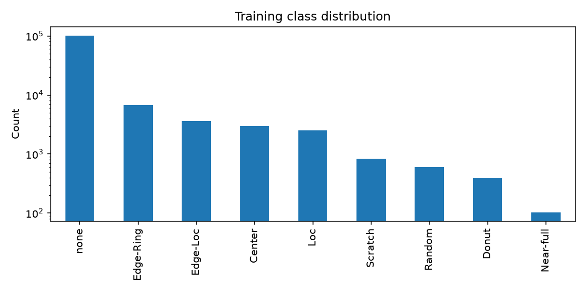
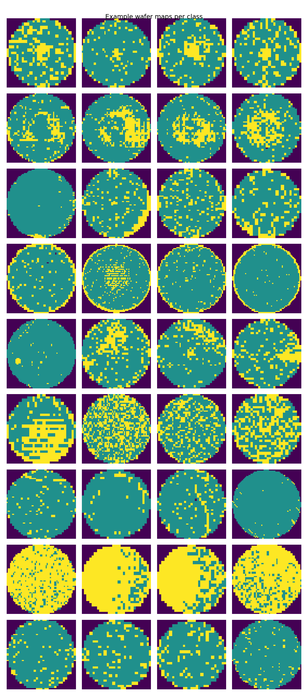
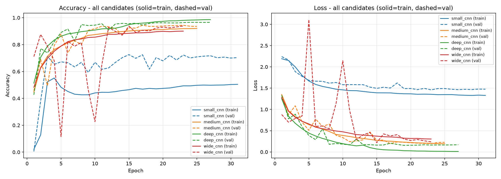
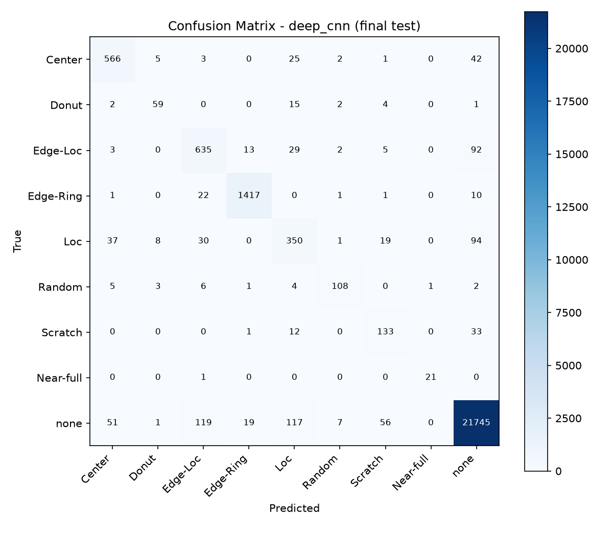
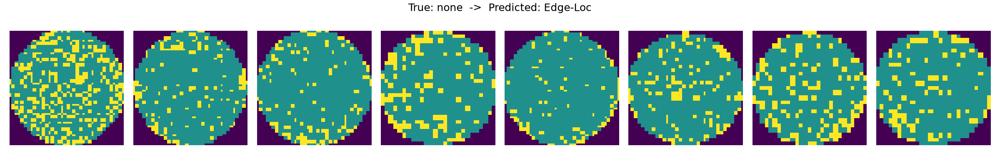
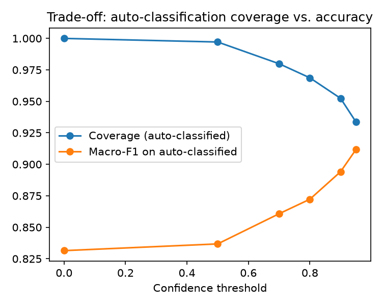

# Wafer Defect Pattern Classification (CNN on WM-811K)

A CNN that classifies semiconductor wafer maps into 9 failure-pattern classes (e.g. `Edge-Ring`,
`Center`, `Scratch`, `Loc`, `none`). I built this as a student project and tried to be careful about
the ML side: comparing architectures fairly, checking for data leakage, using the right metric for
imbalanced data, and thinking about how the output would actually be used in a fab.

## Why this matters

After wafer test, each die on a wafer is marked pass/fail. The *spatial pattern* of failures across
a wafer is a signature of what went wrong upstream: a ring of failures at the edge usually points to
an edge-handling issue, a cluster at the center usually points to non-uniform deposition/etch, and a
thin line points to a physical scratch during handling. Classifying the pattern automatically could
help route failures to the right engineering team faster than manual inspection.

## Results

Dataset: 172,950 labeled wafer maps (121,065 train / 25,942 val / 25,943 test before dedup;
119,702 train / 25,141 val / 25,943 test after dedup).

| Metric | Value |
|---|---|
| Best model | `deep_cnn` (323K parameters) |
| Majority-class baseline (evaluated on test) | 85.2% accuracy, 0.10 macro-F1 |
| Validation macro-F1 | 0.836 |
| Test macro-F1 | 0.831 in the final run (about 0.82-0.83 across runs, see note below) |
| Test accuracy | 96.5% |
| Auto-classification at 0.90 confidence (test set) | 95.2% coverage, macro-F1 0.894 on the auto-classified subset |

The last row is measured only on wafers the model is confident about, so it is not directly comparable
to the full-test macro-F1 of 0.831. Part of the gain is a selection effect. The 0.90 threshold was also
examined on the test set (see Method summary, step 6), so treat this row as descriptive, not as a clean
held-out estimate.

**A note on noise:** I ran the notebook more than once, and test macro-F1 came out at 0.817 in an
earlier run and 0.831 in the final one, even with seeds set (GPU training isn't fully deterministic).
If that earlier run was made before the leakage fix, part of the gap comes from the data change and not
only from run-to-run variation.
So I'd read the result as roughly 0.82-0.83, not a precise number. I also only ran one seed per
architecture, so the ranking of the closer models could change with more runs.

Full per-class metrics, error analysis, and the confidence/coverage trade-off are in the notebook.

## Figures

**Class distribution** (about 85% of wafers are `none`, which is why I used macro-F1 instead of accuracy)



**One example wafer map per class**



**Training curves for all four architectures** (`wide_cnn` is noticeably unstable early on)



**Final test-set confusion matrix (`deep_cnn`)**



**Misclassified wafers for the most common confusion pair**



**Confidence threshold trade-off** (coverage vs. macro-F1 on auto-classified wafers, computed on the test set)



## Repo structure

```
├── wafer_defect_cnn.ipynb        # full pipeline: EDA -> baseline -> model comparison -> error analysis
├── data_loader.py                # loads and preprocesses WM-811K into train/val/test .npz
├── data/                         # (not committed) put LSWMD.pkl and wm811k_processed.npz here
├── figures/                      # saved plots
├── wafer_defect_cnn.keras        # trained model (best candidate)
├── app.py                        # Streamlit demo
└── requirements.txt
```

## Method summary

1. **EDA first:** class balance, example maps per class, and a leakage check. I found exact-duplicate
   wafer maps across the train/val/test splits (660 train/val, 704 train/test, 143 val/test, counted as
   unique duplicated maps). I removed every copy of these from train and val, leaving the test set
   untouched. This took train from 121,065 to 119,702 and val from 25,942 to 25,141.
2. **Baseline:** a majority-class predictor, to show why accuracy is misleading here (85% accuracy,
   0.10 macro-F1). The baseline was evaluated on the test set. It is a constant predictor, so this
   cannot bias model selection.
3. **Model comparison:** four CNN architectures (`small`, `medium`, `wide`, `deep`) trained with the same
   seed, splits, and maximum budget of 35 epochs. Early stopping ended the runs at 31, 25, 27, and 23
   epochs respectively, so the number of epochs actually trained differs.
4. **Model selection on validation only.** The test set was used for the final reported numbers.
   (I did run the notebook more than once, including once before fixing the leakage issue, so the test
   set was evaluated in an earlier run too.)
5. **Error analysis** on the winning model's actual misclassified maps, not just the confusion matrix.
   Of 909 test errors, nearly half (46%) are between `none` and the subtle `Loc`/`Edge-Loc` classes, and
   at least 66% involve `none` being confused with some pattern. This looks like real visual
   ambiguity, though I only inspected a sample of the misclassified maps.
6. **Confidence-based routing:** I swept confidence thresholds (0.0 to 0.95) on the test set and report
   coverage and macro-F1 on the auto-classified subset at each. 0.90 is highlighted as a reasonable
   trade-off, but because the sweep used test data, these numbers are descriptive and not a clean
   held-out estimate. A proper version would choose the threshold on validation and then report test
   results at that fixed threshold. Low-confidence predictions would go to manual review.
7. **Root-cause mapping:** an illustrative mapping from each predicted class to the kind of engineering
   action it might trigger. I made this from general fab knowledge and it hasn't been validated by a
   fab engineer.

## Demo

A small Streamlit app (`app.py`) lets you pick a sample test wafer or upload a preprocessed `.npy`
wafer map and see the predicted class, confidence, and suggested action.

## Setup

1. Download the WM-811K dataset (`LSWMD.pkl`) from Kaggle and put it in `data/`.
2. Then run:

```bash
pip install -r requirements.txt
python data_loader.py
jupyter lab wafer_defect_cnn.ipynb
streamlit run app.py
```

## Known limitations

- Single-label classification only. Real fab data sometimes has overlapping or mixed defect patterns.
- Trained on one dataset/fab process, so generalization to other wafer sizes or fabs is untested.
- The leakage check only finds exact-duplicate maps. It is not a full wafer/lot-ID audit, because the
  version of the dataset I used doesn't include lot IDs.
- Wafer maps are resized to 64x64 with nearest-neighbor interpolation, which stretches non-square maps.
- One training seed per architecture. Run-to-run variation (about 1.4 points of test macro-F1 between
  two runs) is comparable to some of the gaps between models.
- All models started at a learning rate of 1e-4 and were then halved by `ReduceLROnPlateau` (down to
  6.25e-6 by the end of training). Higher starting rates and a proper warmup schedule were not tested.
- The confidence-threshold analysis was run on the test set, so its numbers are not a clean held-out
  estimate.
- The root-cause mapping is illustrative and not validated by domain experts.
- This is a portfolio project, not a production tool.